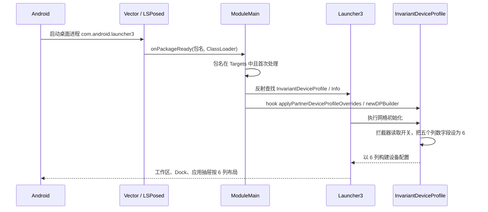
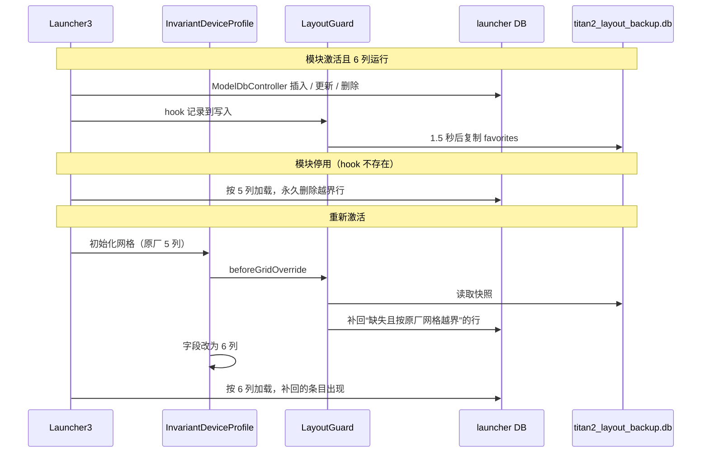
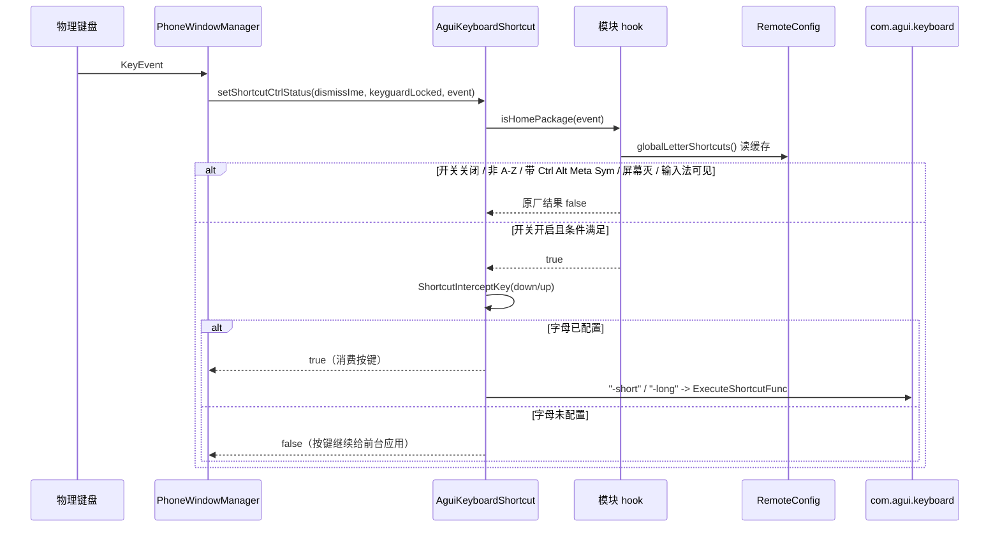

# Key flows

## 桌面 6 列（工作区 / Dock / 应用抽屉）

桌面进程启动时，模块在 `onPackageReady` 阶段安装 hook，等 Launcher3 初始化网格时改写列数：

五个字段：`numColumns`（工作区）、`numShownHotseatIcons` / `numDatabaseHotseatIcons`（Dock）、`numAllAppsColumns` / `numDatabaseAllAppsColumns`（应用抽屉）。

## 桌面布局保护

- **不删**：模块激活但只跑 5 列（6 列开关关闭）时，`LoaderCursor.markDeleted` 被拦截，越界行保留在 DB、不进入内存模型。
- **快照合并**：5 列运行时的新快照会保留旧备份中仍缺失的越界行，避免快照覆盖导致永久丢失。
- **补位**：原位置空闲回原位；冲突或 Dock 满格放到新一页。

## 字母键快捷启动（system_server）

## 开关生效

- UI 开关写入 SharedPreferences 后 `notifyChange`。
- system_server 在下一次字母按键时检查 5 秒 TTL，最多触发一次异步 Provider 读取；读取成功后缓存立即更新，输入线程始终只读缓存。
- 桌面 6 列在每次网格初始化时同步读取（2 秒 TTL），因此必须重启桌面才能应用新的列数。
- 布局保护开关在每次 IDP 初始化、删除判定与数据库写入时读取（2 秒 TTL）。

## 其他重要流程

- **卸载 / 关闭作用域**：目标进程内不再加载模块，桌面列数与字母键行为恢复固件默认；布局保护停止，原厂加载会删除越界行，靠快照在下次激活时补回。
- **找不到 hook 锚点**：桌面回退到构造函数 hook；system_server 找不到 AGUI 类时只记日志并跳过，不影响系统启动；`LayoutGuard` 的锚点缺失时只记 WARN 并退回原厂行为。
- **打开模块界面**：`MainActivity` 展示三个功能开关、列数、目标包名、设备与 SDK 信息；不提供跳转模块管理器的按钮。
