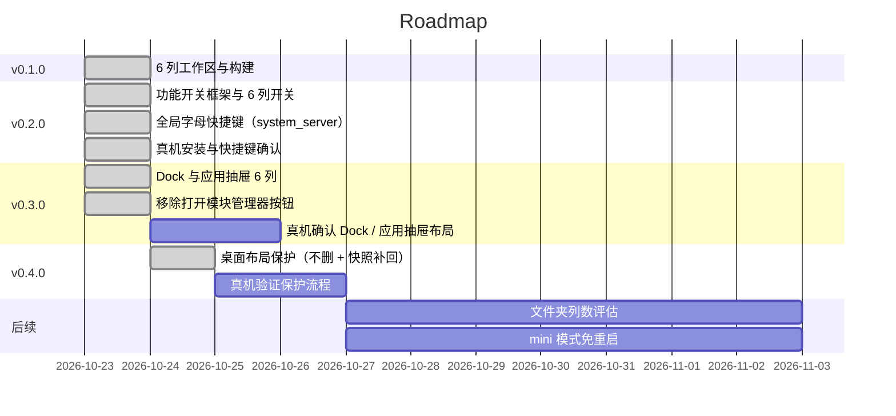

# Roadmap

## Milestones

- **v0.1.0（2026-10-23）**：工作区 6 列 hook、模块说明页、debug/release 构建通过，首个 commit `f901417`。
- **v0.2.0（2026-10-23）**：功能开关框架（SharedPreferences + 只读 Provider）；全局字母快捷键 hook `AguiKeyboardShortcut.isHomePackage`，作用域新增系统框架；用户真机确认字母键全局启动可用。
- **v0.3.0（2026-10-23）**：
  - 同一 hook 同时设置 `numColumns`、`numShownHotseatIcons`、`numDatabaseHotseatIcons`、`numAllAppsColumns`、`numDatabaseAllAppsColumns`，Dock 与应用抽屉也变 6 列；
  - 模块界面删除“打开 Vector / LSPosed 管理器”按钮；
  - release APK（versionCode 3）构建并安装，日志确认五个字段均 5 -> 6。
- **v0.4.0（2026-10-24）**：
  - 新增桌面布局保护开关；`LayoutGuard` 在桌面进程拦截越界条目的 `markDeleted`；
  - 监听 `ModelDbController` 写操作，把 `favorites` 快照到独立数据库；
  - 重新激活时在网格初始化阶段补回模块停用期间被 5 列加载删除的条目；
  - release APK（versionCode 4）构建通过，包含新类与开关。
- **待办**：真机确认 Dock 显示 6 个图标且未被 `DeviceProfile` 自动缩减、应用抽屉为 6 列；关闭开关恢复原厂布局；验证“激活 → 停用 → 再激活”后第 6 列图标补回。
- **后续**：评估文件夹内部列数；mini 模式改为免重启（抑制 `ActivityRecord.shouldRelaunchLocked`）；如需自定义快捷键映射，再考虑独立配置界面。
