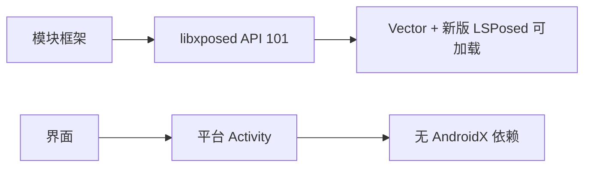

# Tech stack

## Technology choices

| 领域 | 候选 | 决策 | 理由 |
|---|---|---|---|
| 模块框架 | legacy XposedBridge / libxposed API | libxposed API 101 | Vector 与较新的 LSPosed 都支持；模块声明 min/target API 101，编译期依赖 compileOnly |
| 开发语言 | Java / Kotlin | Java 17 | 代码量小，无需附带 Kotlin 运行时，反射写法直接 |
| 构建工具 | Gradle + AGP | Gradle 8.13 + AGP 8.12.0 | 与 compileSdk 36 匹配，wrapper 固定版本保证可复现 |
| Android SDK | min 31 / compile 36 | minSdk 31，compileSdk 与 targetSdk 36 | 覆盖目标固件的 Android 15 / 16 |
| UI | AndroidX / 平台 Activity | 平台 Activity + 代码布局 | 不引入 AndroidX，减小体积，界面仅作说明用途 |
| 签名 | 正式签名 / debug 签名 | Release 复用 debug 签名 | 侧载测试方便，非商店分发；发布正式版前需替换 |

## Decision mindmap

## Open items

- Android 16 的 `newDPBuilder` 签名需在更多固件版本上确认真机行为。
- 若对外发布，需要生成并保管正式签名密钥，替换当前 debug 签名。
